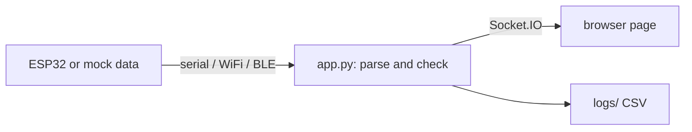

# Dashboard

Live sensor dashboard for the SolarYou stabilization platform. It reads
telemetry from the ESP32 over serial, WiFi, or BLE and shows it in a
browser. Mock mode makes up data so you can run it without a board.

Working on the firmware side? See `ESP32_INTEGRATION.md` for the message
format, what each connection needs, and troubleshooting. The BLE message
format is in `BLE_PROTOCOL.md`.



## Setup

Needs Python 3.9 or newer (`python3 --version`).

From this `dashboard/` folder:

```
python3 -m venv env
source env/bin/activate        # Windows: env\Scripts\activate
pip install -r requirements.txt
cp config.example.json config.json    # only needed for WiFi, BLE, or a fixed serial port
```

`config.json` is gitignored, so each person keeps their own.

## Running

```
python app.py                  # mock data (default)
python app.py --mock-tracking  # mock data that follows a moving sun target
python app.py --source serial
python app.py --source wifi
python app.py --source ble
```

Then open http://localhost:5001. The badge in the header turns green once
data is arriving. If it says "Connected, waiting for data", the link is up
but nothing usable has come through, so check the terminal.

- Serial finds the board on its own. `--list-ports` shows what it sees and
  `--serial-port COM5` (or `/dev/cu.usbmodem1101`) picks one by hand.
- `--port 5002` if 5001 is taken.
- `--debug` turns on Flask's debugger, which anyone on the network can
  reach. Leave it off for demos.

Every flag and setting is listed in `ESP32_INTEGRATION.md`, section 3.

| Source | Needs in config.json |
|---|---|
| mock | nothing |
| serial | nothing, or `serial_port` to pick one |
| wifi | `wifi_url` |
| ble | `ble_name`, `ble_characteristic` |

A missing field is reported on the badge and in the terminal.

## What's on the page

| Part | Shows |
|---|---|
| Pitch, Roll | latest angles. `--` means the sensor reported invalid or nothing arrived for 5 s. |
| Power | latest reading, with the 60 s average under it |
| Energy | power added up since the page opened or the last New run |
| Pitch & Roll chart | last 30 s |
| Tilt from level | how far the panel is from flat, a bubble level with a short trail, RMS tilt over 30 s, and the share of readings within 2° |
| Panel attitude | side and front views at the real angles |
| Power chart | last 60 s |
| New run | resets the stats and energy and starts a new run number |
| Export CSV | every reading this page received, with a run column (UTC times) |
| Send rate | BLE only. Sets 1, 2, 5, or 10 readings a second and shows the rate the board confirms. |

If the firmware sends `pitch_target` and `roll_target`, the page measures
error from the target instead of from level, and the charts and drawings
show the target too. When the targets stop, it goes back to level.

Notes on the numbers:

- Without targets, tilt is measured from level. That is only the real
  error while the controller is holding level.
- RMS tilt comes from the telemetry rate (5 to 10 a second), so treat it
  as an indicator, not a precise stability figure.
- The 2° band is set by `BAND_DEG` at the top of
  `static/js/dashboard.js`.
- Energy is estimated in the browser and resets on reload.
- If a drawing tilts the wrong way, flip `PITCH_DRAW_SIGN` or
  `ROLL_DRAW_SIGN` at the top of `dashboard.js`.

The sun/moon button switches between dark and light themes. Three line
color sets are built in: add `?palette=reef` (default), `lagoon`, or
`sunset` to the address. All colors are CSS variables at the top of
`static/css/style.css`.

## Saved readings

With serial, WiFi, or BLE, every reading is also written to a CSV in
`logs/`, with the same columns as Export CSV. Use these for test runs and
TinyML data, since the page's copy is lost on reload.

- One file per session, named by start time. New run starts a new file
  (`..._run2.csv`), and a file over 50 MB continues in `..._part2.csv`.
- About 1 MB per hour at 5 readings a second. Nothing is deleted
  automatically; the terminal warns if `logs/` passes 500 MB.
- Mock data isn't saved unless you add `--log`. `--no-log` turns saving
  off for any source.
- New run in any open browser starts the new file.
- If saving fails, the terminal says so once and the dashboard keeps
  running.

## Viewing from another device

Other devices on the same WiFi network can open `http://<this-ip>:5001`.
Find the IP with `ipconfig getifaddr en0` (Mac) or `ipconfig` (Windows).
Chart.js and Socket.IO are bundled locally, so the page works without
internet access.

## Tests

```
python -m unittest discover -s tests -v
```

No hardware needed. `tools/fake_esp32_ws.py` is a stand-in ESP32 for
trying the WiFi source (see `ESP32_INTEGRATION.md`, section 6).

## Known issues

- **Port 5000 on macOS**: AirPlay Receiver uses it, which is why the
  default is 5001.
- **Firewall prompt**: allow incoming connections for Python the first
  time, or other devices can't reach the page.
- **BLE on macOS**: macOS hides Bluetooth addresses, so the dashboard
  finds the board by its advertised name (`ble_name`). The first scan may
  ask for Bluetooth permission.

## Files

```
dashboard/
  app.py                  Flask server and the four data sources
  ble_transport.py        BLE receiver (Jennifer)
  BLE_PROTOCOL.md         BLE message and rate format (Jennifer)
  ESP32_INTEGRATION.md    message format and firmware guide
  config.example.json     copy to config.json
  requirements.txt
  logs/                   saved readings (gitignored)
  tools/fake_esp32_ws.py  stand-in ESP32 WebSocket server
  tests/                  unit tests
  templates/index.html
  static/
    css/style.css
    js/dashboard.js
    js/telemetry-rate.js  BLE send-rate selector (Jennifer)
    js/vendor/            Chart.js and Socket.IO, bundled
```
