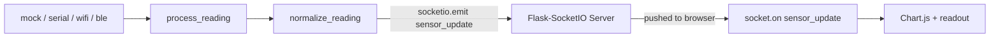

# Dashboard (Debug View)

Live sensor dashboard for the stabilization platform. Supports four data
sources, picked at startup with --source. Mock (the default) is what
everyone should run until the ESP32 side has real data.

Working on the ESP32 firmware? Read `ESP32_INTEGRATION.md`. It starts with
a serial quickstart for Demo 1 and covers the message format, what each
connection type needs, and how to debug it.

## How it works



## Setup

1. Make sure you have Python 3.9 or newer installed (`python3 --version` to check).

2. From this `dashboard/` folder, create and activate a virtual environment:
   ```
   python3 -m venv env
   source env/bin/activate        # Windows: env\Scripts\activate
   ```

3. Install dependencies:
   ```
   pip install -r requirements.txt
   ```
   This is only the five packages the dashboard uses. TensorFlow is not
   needed here (the ML packages live in `requirements-ml.txt`).

4. Optional: create your own local config (gitignored, each person's
   values differ):
   ```
   cp config.example.json config.json
   ```
   Mock and serial work without it. You only need it for WiFi, BLE, or to
   pin a specific serial port.

5. Run the server:
   ```
   python app.py                  # mock (default)
   python app.py --mock-tracking  # mock that follows a moving sun target
   python app.py --source serial
   python app.py --source wifi
   python app.py --source ble
   ```
   Serial finds the board on its own. `python app.py --list-ports` shows
   what it sees, and `--serial-port COM5` (or `/dev/cu.usbmodem1101`)
   picks one by hand.

   Optional: `--port 5002` if 5001 is taken. `--debug` turns on Flask's
   debug mode, which exposes a debugger page to everyone on the network,
   so leave it off for demos.

6. Open a browser to:
   ```
   http://localhost:5001
   ```
   You should see the dashboard with a connection status badge in the
   header and everything updating. Mock mode sends 5 readings a second
   and repeats a tilt-then-settle cycle every 40 seconds. The badge turns
   green once data is arriving. If it says
   "Connected, waiting for data", the link is up but nothing usable has
   come through yet, so check the terminal for warnings.

## What each source needs in config.json

| Source | Required fields |
|---|---|
| mock | none |
| serial | nothing (finds the board), or serial_port to pick one |
| wifi | wifi_url |
| ble | ble_name, ble_characteristic |

A missing field shows up clearly in the terminal and on the status badge,
not as a silent failure. Optional extras (`serial_baud`,
`wifi_idle_timeout`) are listed in `ESP32_INTEGRATION.md`.

## What's on the page

| Part | Shows |
|---|---|
| Pitch, Roll | the latest angles, big. `--` means the sensor reported invalid or nothing arrived for 5 s. |
| Power | the latest reading, with the average over the last 60 s under it |
| Energy | power added up over time since the page opened or the last New run |
| Pitch & Roll chart | the last 30 s, hover for exact values |
| Tilt from level | the level card. The big number is how far the panel is from flat right now. Below it, a bubble level (roll left and right, pitch up and down, with a short trail; a hollow dot on the edge means past 10°), the RMS tilt over the last 30 s (lower is steadier), and the share of readings within 2°. |
| Panel attitude | side and front views of the panel at the real angles |
| Power chart | the last 60 s |
| New run | clears the stability stats and energy total and starts a new run number |
| Export CSV | downloads every reading this page received since it was opened, with a run column. Times are UTC. |
| Sun/moon button | switches between the dark theme (default) and a light one. The browser remembers the choice. |

If the firmware sends `pitch_target` and `roll_target` (the sun angle the
controller is steering toward), the page switches on its own: the level
card measures error from the target, Pitch and Roll show their targets
underneath, the chart adds dashed target lines, and the dashed outline in
Panel attitude shows the target. When the targets stop, it goes back to
level.

### Colors

All colors are CSS variables at the top of `static/css/style.css`, and
the charts read them from there. Three line-color sets are built in,
each checked for color-blind separation and contrast in both themes.
Add one to the address to try it, for example
`http://localhost:5001/?palette=lagoon`:

| palette | Pitch | Roll |
|---|---|---|
| `reef` (default) | cyan | coral |
| `lagoon` | sea green | coral |
| `sunset` | cyan | amber |

Power is gold in all three. `?theme=light` works the same way. Both are
remembered in that browser until changed.

Things to keep in mind when presenting these:

- Without targets in the telemetry, tilt is measured from level. That is
  only the real error while the controller is holding level. With sun
  tracking on, send the targets so the level card shows tracking error.
- RMS tilt comes from the telemetry rate (5 to 10 a second), so it is an
  indicator, not a benchmark to quote against the SOMAG 0.3° figure.
- The 2° band is a placeholder. Change `BAND_DEG` at the top of
  `static/js/dashboard.js` once the team agrees on a number.
- Energy is estimated in the browser from when readings arrive, and resets
  if the page reloads.
- If a drawing tilts the opposite way from the real platform, flip
  `PITCH_DRAW_SIGN` or `ROLL_DRAW_SIGN` at the top of `dashboard.js`.
- For a stabilized vs. fixed comparison, use New run between the two and
  split the CSV by the run column.

## Viewing from another device (phone, another laptop)

The server is already bound to your machine's network address (not just
localhost), so as long as the other device is on the **same WiFi network**:

1. Find this machine's local IP address:
   - Mac: `ipconfig getifaddr en0`
   - Windows: `ipconfig` (look for IPv4 Address)
2. On the other device, go to `http://<that-ip>:5001`

Chart.js and Socket.IO are bundled in `static/js/vendor/` instead of
loaded from the internet, so the page also works with no internet
connection, including over BLE with no WiFi at all.

## Extra info

- **Port 5001, not 5000**: macOS runs AirPlay Receiver on port 5000 by
  default, which blocks Flask from using it. If you ever see a 403 error on
  port 5000, this is why.
- **Firewall prompt**: the first time you run this, macOS may ask whether to
  allow incoming network connections for Python. Allow it, or other devices
  won't be able to reach the dashboard.
- **BLE on macOS**: macOS doesn't give apps a device's real Bluetooth
  address, so the dashboard finds the ESP32 by its advertised name
  instead. That's why BLE uses `ble_name` where WiFi uses an address.

## File structure

```
dashboard/
  .gitignore                 <- keeps config.json and Python caches out of git
  app.py                     <- Flask server + all four data sources
  ESP32_INTEGRATION.md       <- message format and firmware guide
  config.example.json        <- template, copy to config.json
  config.json                <- your own local settings, gitignored
  requirements.txt           <- just what the dashboard needs
  requirements-ml.txt        <- full package list incl. TensorFlow (later)
  tools/
    fake_esp32_ws.py          <- stand-in ESP32 WebSocket server for testing
  tests/
    test_messages.py          <- checks for the message handling
    test_serial.py            <- checks for port picking and line splitting
  templates/
    index.html                <- page structure
  static/
    js/
      dashboard.js             <- receives readings, draws the page
      vendor/
        chart.umd.js            <- Chart.js, bundled locally
        socket.io.min.js        <- Socket.IO client, bundled locally
    css/
      style.css                <- styling
```
